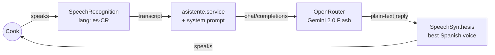
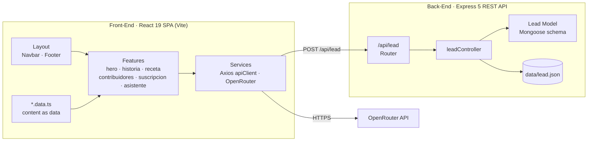

<h1 align="center">🍝 Sabor & Provincia</h1>

<p align="center">
  <em>Rescuing the culinary heritage of Turrialba, one recipe at a time.</em><br/>
  <strong>Immersive culinary landing page with a voice-driven AI cooking assistant that speaks Costa Rican Spanish</strong>
</p>

<p align="center">
  
  
  
  
  
  
</p>

---

## 🍝 Overview & Purpose

**Sabor & Provincia** is a culinary storytelling platform that preserves the gastronomic identity of **Turrialba, Cartago (Costa Rica)**. It is built around one signature dish, *Fettuccine con Salsa Turrialbeña*, made with the region's famous artisanal Turrialba cheese.

It is more than a digital cookbook. It combines **cultural storytelling**, an **interactive recipe** and **Chef Turrialba**, a hands-free voice assistant that cooks with you in real time so you never have to touch the screen with flour on your hands.

---

## ⚡ What It Does

| Section | Experience |
| :--- | :--- |
| **🌋 Hero** | Full-bleed landing with recipe metadata: prep time, servings, difficulty and origin. |
| **📜 Historia** | The story of the dish, born on the slopes of the Turrialba volcano where Italian pasta meets Tico dairy tradition. |
| **🥘 Receta** | Tabbed UI that switches between the ingredients list and the step-by-step procedure. |
| **📸 Contribuidores** | Cards for the project's collaborators (food photographer and digital magazine) with hover reveals. |
| **💌 Suscripción** | Lead-capture form connected to the Express API. |
| **🎙️ Chef Turrialba** | A floating voice assistant: speak a question, get a spoken answer. |

Every section animates in on scroll using a custom `useOnScreen` hook (Intersection Observer) and Animate.css.

---

## 🧠 Chef Turrialba: Voice AI Pipeline

The assistant runs a complete **speech → LLM → speech** loop with no extra audio infrastructure, using only the browser's native APIs:



- **State machine UI:** `inactive → listening → processing → speaking`, with a single button to start, stop or interrupt.
- **Smart voice selection:** prefers an `es-CR` voice, then high-quality Spanish voices (Google / Microsoft / Natural), then any local Spanish voice.
- **Prompt engineering:** a dedicated system prompt (`prompts/chefTurrialba.md`, imported with Vite's `?raw`) defines the persona, Costa Rican *voseo*, 3–4 sentence answers and step-by-step flow control. It also handles off-topic questions and **forbids Markdown**, because the speech synthesizer would read symbols out loud.
- **Graceful degradation:** friendly in-character fallbacks for rate limits (`429`), network errors and unsupported browsers.

---

## 🏛️ Architecture



### Architectural Highlights

- **Feature-based front-end:** each section is a self-contained module (`component + styles + *.data.ts`). Copy lives in typed data files, separate from the JSX, so content can change without touching the UI.
- **Layered REST API:** `index.js → apiRouter → routes → controllers → models`, built with ES Modules and Express 5.
- **Schema-validated leads:** subscriptions are shaped by a Mongoose model (IDs and a clean `toJSON`) and saved to a local JSON store. A MongoDB connection module (`config/db.js`) is ready to enable.
- **Design tokens:** plain CSS custom properties for color, typography and spacing, with editorial Google Fonts (DM Serif Display, DM Sans, Elsie).

---

## 💻 Tech Stack

| Layer | Technologies |
| :--- | :--- |
| **Front-End** | React 19, React Router 7, Vite 8, Axios, React Icons |
| **Styling & Motion** | CSS custom properties, Animate.css, Intersection Observer, Google Fonts |
| **AI & Voice** | OpenRouter (Gemini 2.0 Flash), Web Speech Recognition, Speech Synthesis |
| **Back-End** | Node.js, Express 5, CORS, Mongoose 9 |
| **Tooling** | pnpm, ESLint |

---

## 📂 Repository Structure

```text
Sabor & Provincia/
├── Front-End/
│   ├── public/images/        # Hero, story, recipe & contributor imagery
│   └── src/
│       ├── features/         # hero · historia · receta · contribuidores · suscripcion · asistente
│       ├── components/       # Layout, Navbar, Footer, HoverText
│       ├── services/         # Axios client, subscription & AI services
│       ├── prompts/          # Chef Turrialba system prompt
│       ├── hooks/            # useOnScreen (scroll animations)
│       └── styles/           # Design tokens, typography, globals
└── Back-End/
    ├── routes/ · controllers/ · models/
    ├── config/               # Env + MongoDB connection
    └── data/                 # Local JSON lead store
```

---

## 🚀 Quickstart

**Prerequisites:** Node.js 20+ · pnpm · an [OpenRouter](https://openrouter.ai/) API key · Chrome or Edge (for speech recognition)

```bash
git clone https://github.com/DereckGC/Sabor-Provincia.git
cd "Sabor-Provincia/Sabor & Provincia"
```

**Back-End** (`http://localhost:5000/api`)
```bash
cd Back-End
pnpm install
node index.js
```

**Front-End** (`http://localhost:5173`)
```bash
cd Front-End
pnpm install
echo "VITE_OPENROUTER_API_KEY=your_api_key" > .env
pnpm dev
```

---

<p align="center">
  Made with 🧡 from Turrialba, Costa Rica
</p>
